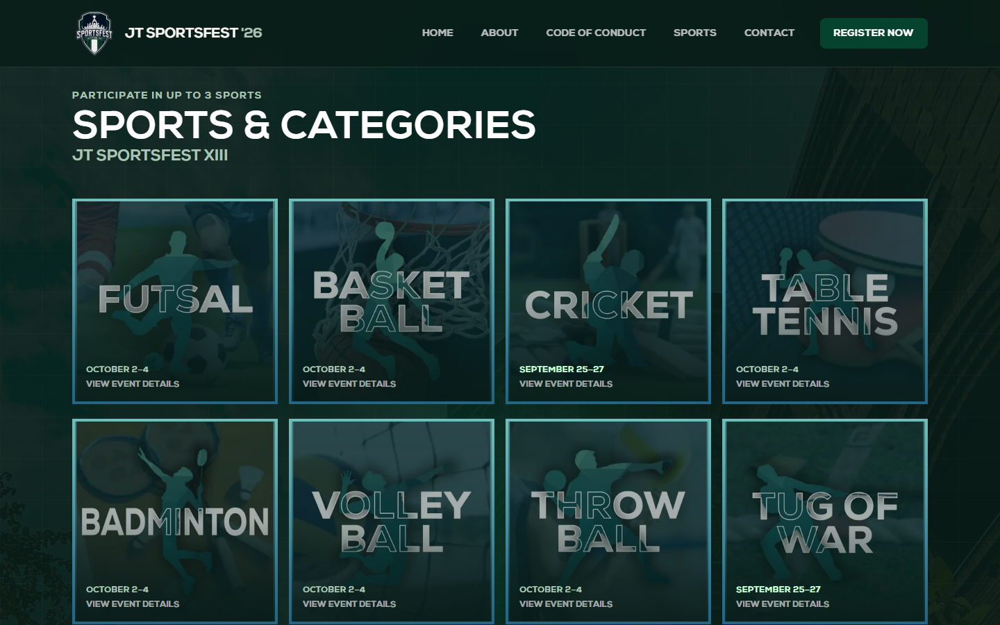
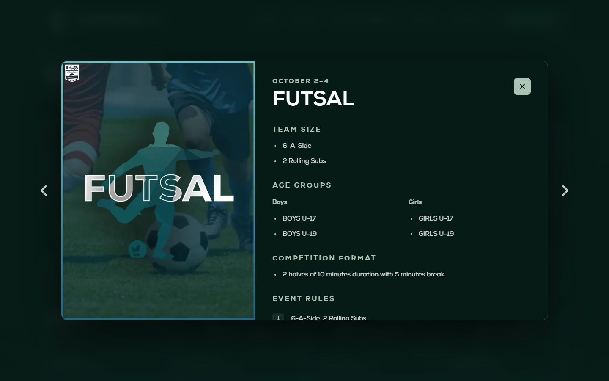
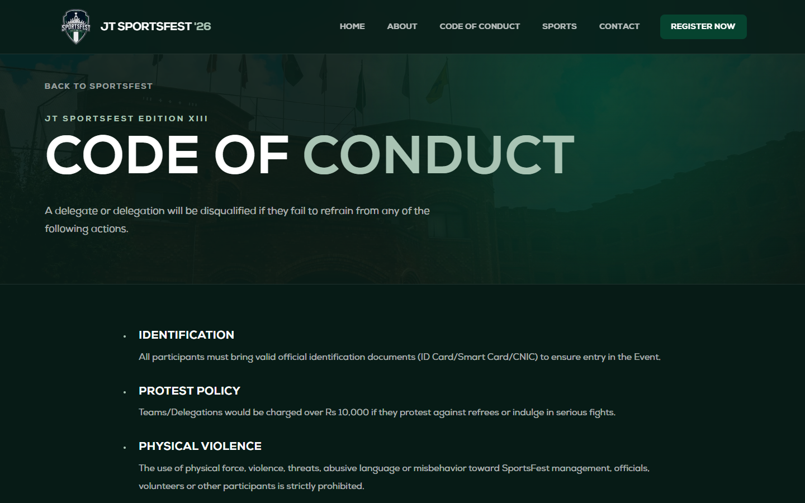
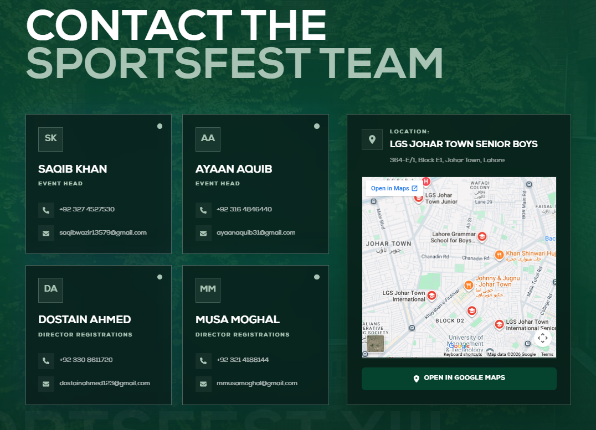

# JT SportsFest XIII

This is the website for the 13th edition of JT SportsFest at LGS Johar Town. It gives participants a place to browse the sports, check the rules, register, and help contact the organising team.


## Visit the website

Click here to visit the website: [https://www.lgsjtsportsfest.com/](https://www.lgsjtsportsfest.com/)

```bash
https://www.lgsjtsportsfest.com/
```

Alt link: [https://jtsportsfest26.vercel.app/](https://jtsportsfest26.vercel.app/)

```bash
https://jtsportsfest26.vercel.app/
```

## Running Locally:

You'll need Next.js and npm installed. From the project folder, run:

```bash
npm install
npm run dev
```
Open [localhost:3000](http://localhost:3000/) to view the site; it updates as you save your changes.
Important Note: You must be in the root folder while running the commands.
## Structure:

### Home:
The site uses a greenish theme with Nexa Bold Font headings. The header becomes more compact as you scroll. The homepage introduces the sports (in its respective section - this is to ensure that user is met with most important thing without scrolling too much), sponsors, and the event management team contacts.


### Sports & Categories:

The sports page has all 20 sports in one grid. Each card has its own image and event dates, so participants can browse before opening the details. A static panel was added to finish off the grid (4x5), for mobiles it is optimized to have an extra row to complete the grid (2x11).



### Sports Details:

Clicking a sport opens a panel which states all the rules relevant to the sport. The rules include team size, age groups, competition format, and game rules. Footwear requirements and extra notes may be added too depending on the sport's requirements. I also added arrows for easier navigation between each rules.



### Code of Conduct:

The Code of conduct and other general rules are stated inside the ```code of conduct``` page. It covers things like identification, behaviour, and care for the school's facilities and equipment.



### Registration:

The registration page embeds a Fillout form. The project also initially had an API route for fetching the total number of teams registered for the event, this was later removed as per request.

### Contact and location:

The contact section lists the event heads and registration directors alongside their phone and email links. An embedded map and a Google Maps link of the school is attached here for users to easily find their way to the destination. 



## Search and sharing

The site includes page descriptions, canonical URLs, social sharing metadata, a sitemap, and a robots file. The sharing image gives links to the site a SportsFest preview. It is also connected to Google Search Console to monitor its visibility in Google Search.

## Credits:

**Website Design & Structure: [Ahmad Hassan](https://github.com/ahmad-56)**
